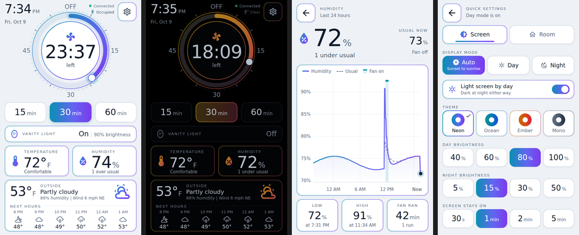

# Wink Relay for Home Assistant

> **AI use:** Claude Code wrote the daemon patch, scripts, Home Assistant packages, wall page and this guide. A person directed the work and tested it on one Relay in daily use since September 2026. Most of the code has not been read line by line.

The Wink Relay is a wall switch with a 4 inch touchscreen, two relays, two
buttons and temperature, humidity, light and proximity sensors. Wink's cloud
is long gone, but the hardware still works well. Inside, it runs Android 4.3.
This guide turns one into a local Home Assistant device, with no cloud
involved:

- Both relays, both buttons (press, double press, hold) and every sensor show
  up in Home Assistant over MQTT, as one device.
- The screen shows a wall dashboard built for it: a fan timer dial, quick run
  buttons, room temperature and humidity with 24 hour graphs, the weather,
  quick settings, day and night looks, and alert banners.
- A bathroom fan package that switches the fan on with shower steam and off
  once the room is dry, plus timed runs, a motion-lit vanity light that dims
  at night, and the buttons wired to all of it.

Everything here has run on one Relay, which has been in a bathroom wall
running the exhaust fan since September 2026. The screenshots above come from
the page's offline test harness with made-up readings.

## The guide

1. [Before you start](docs/1-before-you-start.md): what you need, wiring and safety.
2. [Get into the Relay](docs/2-get-into-the-relay.md): Wi-Fi, adb and root.
3. [Install the daemon](docs/3-install-the-daemon.md): replace Wink's software with wink-relay-manager plus this repo's patch.
4. [Connect it to Home Assistant](docs/4-home-assistant.md): MQTT discovery and the packages.
5. [Put the dashboard on the wall](docs/5-wall-dashboard.md): build the page, give it a token, and keep it on screen.
6. [Sensors and calibration](docs/6-sensors-and-calibration.md): what the sensors can and cannot tell you.

Reference: [MQTT topics and daemon settings](docs/mqtt-reference.md),
[home screen layouts](docs/layout.md), [troubleshooting](docs/troubleshooting.md).

## What is in this repo

| Folder | What |
|---|---|
| `daemon/` | A patch for [wink-relay-manager](https://github.com/jimpastos/wink-relay-manager) 1.3 that adds the light, proximity and presence sensors, an MQTT last will, screen brightness and timeout from Home Assistant, a relay time limit and several crash fixes; a script that builds it; an example config |
| `device/` | Scripts run from your computer over adb: install and roll back the daemon, set up the browser, load the panel's token, and a boot hook that keeps the dashboard on screen and the Wi-Fi responsive |
| `homeassistant/` | The MQTT discovery publisher and two Home Assistant packages (the panel, and the bathroom fan) |
| `panel/` | The wall dashboard's source, its build script, an example config and an offline test harness |

## Licenses

This repo's own work is under the [BSD Zero Clause License](LICENSE): use it
however you like, no attribution needed.

- wink-relay-manager is not included. `daemon/build.sh` downloads it from
  its author's repository and applies the patch. That project has no license
  file, so its code stays its author's; the patch carries only our changes
  and the few lines of context needed to apply them.
- The icons in `panel/icons/` are from Material Design Icons, under the
  Apache License 2.0.
- The Android NDK, Home Assistant, Mosquitto and paho-mqtt are used as tools
  and are not redistributed here.

Wink and Wink Relay are trademarks of their owner. This project is not
affiliated with or endorsed by Wink.
